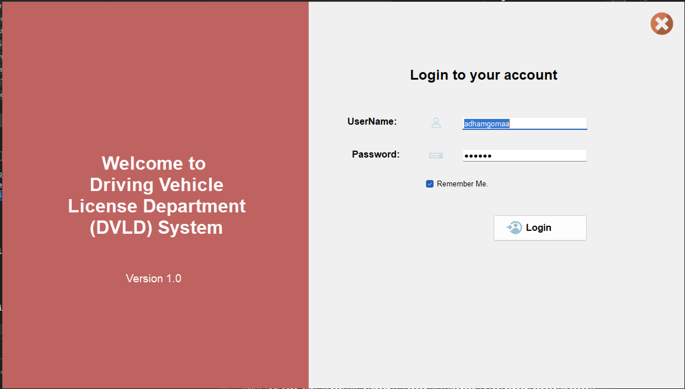
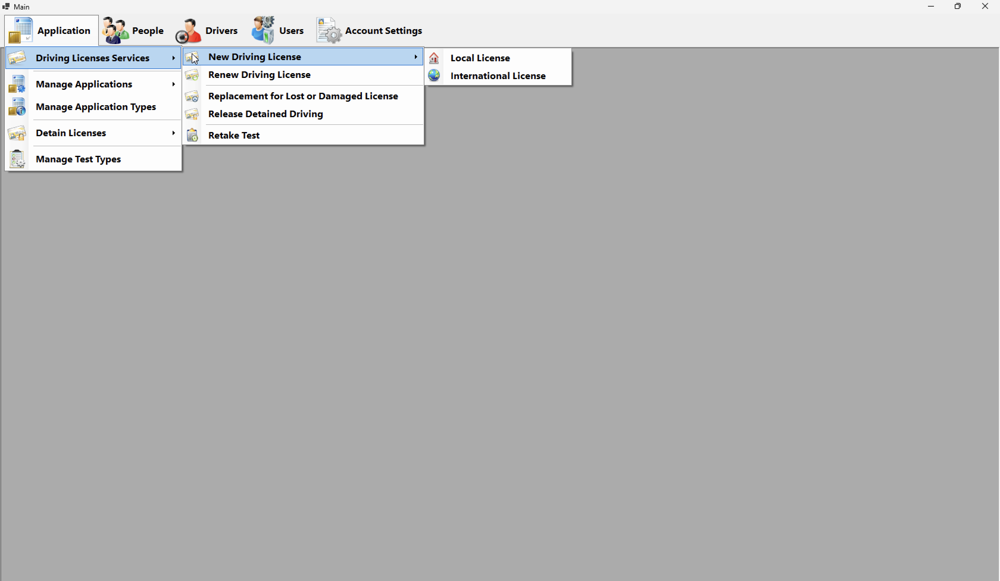

# DVLD - Driving and Vehicle License Department

<p align="center">
  
  
  
  
  
</p>

<p align="center">
  
  
  
  
  
</p>

DVLD is a full-stack desktop application that models the core workflows of a driving and vehicle license department. It combines a Windows Forms client with an ASP.NET Core REST API and Microsoft SQL Server, covering person records, system users, applications, test appointments, license issuance, renewals, replacements, international licenses, and license detention.

The repository demonstrates a layered architecture, interface-based dependency injection, DTO mapping, asynchronous data access, JWT authentication, refresh-token rotation, BCrypt password hashing, centralized HTTP communication, and database views and procedures.

---

## Contents

- [Key Features](#key-features)
- [Screenshots](#screenshots)
- [System Architecture](#system-architecture)
- [Solution Structure](#solution-structure)
- [Technology Stack](#technology-stack)
- [Core Domain Workflows](#core-domain-workflows)
- [Authentication and Security](#authentication-and-security)
- [API Surface](#api-surface)
- [Database](#database)
- [Getting Started](#getting-started)
- [Configuration](#configuration)
- [Running the Projects](#running-the-projects)
- [Author](#author)

---

## Key Features

### People and users

- Create, update, search, and delete people.
- Enforce unique national numbers.
- Store nationality, personal details, contact information, and profile images.
- Create system users linked to people.
- Activate or deactivate accounts.
- Change passwords using BCrypt verification and hashing.

### Applications and drivers

- Manage application types and fees.
- Track application status and lifecycle dates.
- Register people as drivers.
- Search and list drivers with personal and license information.

### Local driving license workflow

- Submit a local driving-license application.
- Select a license class and validate eligibility.
- Schedule vision, theory, and practical test appointments.
- Prevent duplicate active appointments and retake misuse.
- Record test results and track passed tests and attempts.
- Issue a local license after requirements are completed.
- View local-license history for a driver.

### License operations

- Renew an existing license.
- Replace a lost or damaged license.
- Deactivate licenses.
- Detain and release local licenses.
- Create and track release applications.
- Issue international driving licenses.
- Review international-license applications and history.

### Administrative and reporting screens

- Application and test-type configuration.
- License-class management.
- Detained-license management.
- License history and active-license searches.
- Database-backed views for driver and local-application summaries.

---

## Screenshots

<p align="center">
  
  
</p>

| Area | Screenshot |
|---|---|
| People management | [Manage People](./Screenshots/Manage%20People.png) |
| User management | [Users and Drivers](./Screenshots/Users%20&%20Drivers.png) |
| Add user | [Add User](./Screenshots/Add%20User.png) |
| User details | [User Info](./Screenshots/User%20Info.png) |
| Application types | [Application Types](./Screenshots/Application%20Types.png) |
| Test types | [Test Types](./Screenshots/Test%20Types.png) |
| Local applications | [Local License Applications](./Screenshots/Local%20License%20Applications.png) |
| Local license | [Local License](./Screenshots/Local%20License.png) |
| International applications | [International License Applications](./Screenshots/International%20License%20Applications.png) |
| International license | [International License](./Screenshots/International%20License.png) |
| License history | [License History](./Screenshots/License%20History.png) |
| License detention | [Detain Licenses](./Screenshots/Detain%20Licenses.png) |
| Lost or damaged replacement | [Replace License](./Screenshots/Replace%20License.png) |

---

## System Architecture

```text
┌─────────────────────────────────┐
│  Windows Forms Presentation     │
│  Forms, controls, API services  │
└────────────────┬────────────────┘
                 │ HTTPS / REST / JSON
                 ▼
┌─────────────────────────────────┐
│  ASP.NET Core Web API           │
│  Controllers, DTOs, JWT auth    │
└────────────────┬────────────────┘
                 │
                 ▼
┌─────────────────────────────────┐
│  Business Layer                 │
│  Domain rules and orchestration │
└────────────────┬────────────────┘
                 │
                 ▼
┌─────────────────────────────────┐
│  Data Access Layer              │
│  Repository interfaces and EF Core │
└────────────────┬────────────────┘
                 │
                 ▼
┌─────────────────────────────────┐
│  Microsoft SQL Server           │
│  Tables, views, procedures, constraints │
└─────────────────────────────────┘
```

### Architectural responsibilities

| Layer | Responsibility |
|---|---|
| Windows Forms | User interaction, form validation, session state, and API calls |
| API | HTTP endpoints, request validation, response codes, authentication, and authorization |
| DTOs | Stable client/server contracts and data transfer |
| Business | Domain rules, password verification, login, licensing, and refresh-token orchestration |
| Data access | EF Core queries, updates, transaction coordination, and database mappings |
| Database | Referential integrity, constraints, views, procedures, and stored domain data |

The API registers services and data implementations through ASP.NET Core dependency injection. Cancellation tokens are propagated through the API, business, and data-access boundaries for asynchronous operations.

---

## Solution Structure

```text
DVLD-v2/
├── DVLD.Client/
│   ├── DVLD.Client.sln
│   └── DVLD.WinForms/
│       ├── Forms/
│       ├── Services/
│       ├── Helpers/
│       ├── Resources/
│       └── appsettings.json
├── DVLD.Server/
│   ├── DVLD.Server.sln
│   ├── DVLD.API/
│   │   ├── Controllers/
│   │   ├── Configuration/
│   │   ├── Implementations/
│   │   └── Mappers/
│   ├── DVLD.Business/
│   │   ├── Implementations/
│   │   └── Interfaces/
│   ├── DVLD.DataAccess/
│   │   ├── Data/
│   │   ├── Implementations/
│   │   └── Interfaces/
│   ├── DVLD.DTOs/
│   └── DVLD.Shared/
│       ├── Models/
│       └── Enums/
├── Database/
│   └── database.sql
└── Screenshots/
```

The server and client are separate solutions so each can be built and run independently. The DTO project is shared with the WinForms client.

---

## Technology Stack

| Area | Technologies |
|---|---|
| Client | C#, Windows Forms, .NET 8, `HttpClient`, async/await |
| API | ASP.NET Core 8, REST, JWT Bearer authentication, Swagger/OpenAPI |
| Business | Interface-based services, dependency injection, BCrypt |
| Data access | Entity Framework Core 8, SQL Server provider |
| Database | Microsoft SQL Server, T-SQL, tables, views, constraints, procedures |
| Security | BCrypt, HMAC SHA-256 JWT signing, refresh-token hashing, HTTPS, CORS, rate limiting |

---

## Core Domain Workflows

### Local driving license issuance

```text
Person
  → Create application
  → Select license class
  → Schedule test appointments
  → Record test results
  → Pass required test types
  → Register as a driver
  → Issue local license
  → Renew / replace / detain / release / deactivate
```

### International license issuance

```text
Person → Driver → Active local license
  → Validate eligibility
  → Create international application
  → Issue international license
  → Track international license history
```

### Detained-license release

```text
Select detained license
  → Create release application
  → Record detention and release fees
  → Update release status
  → Store release date and releasing user
```

---

## Authentication and Security

### Authentication flow

1. The login form sends credentials to `POST /api/Auth/login`.
2. The API records the login attempt and verifies the account and BCrypt password hash.
3. A successful login creates a short-lived JWT access token and a longer-lived refresh token.
4. `BearerTokenHandler` attaches the access token to protected API requests.
5. If a request receives `401 Unauthorized`, the client synchronously attempts a refresh.
6. The refresh endpoint rotates the refresh token and returns a new access/refresh pair.
7. Logout revokes the supplied refresh token and the client clears its session.

```text
Login
  ↓
Access token + refresh token
  ↓
Bearer authorization header
  ↓
Access token expires
  ↓
Refresh token rotation
  ↓
Retry original request
```

### Authentication endpoints

| Endpoint | Method | Description |
|---|---|---|
| `/api/Auth/login` | `POST` | Authenticate a user and issue tokens |
| `/api/Auth/refresh` | `POST` | Rotate a refresh token and issue new tokens |
| `/api/Auth/logout` | `POST` | Revoke a refresh token |

### Security controls

- BCrypt password hashing and verification.
- JWT issuer, audience, lifetime, signing-key, and HMAC SHA-256 validation.
- No expiration bypass or zero clock skew.
- Configurable access-token and refresh-token lifetimes.
- Refresh-token hashes stored rather than plaintext token values.
- Refresh-token replacement, expiry, and revocation records.
- Login, refresh, logout, and global fixed-window rate limits.
- CORS allowlist for configured client origins.
- HTTPS redirection and HSTS outside development.
- Swagger Bearer security metadata.
- A default authorization fallback for non-anonymous controller actions.

The JWT signing key must be configured as a secret and must contain at least 32 UTF-8 bytes. Never commit a production signing key or database credential.

---

## API Surface

The API is organized by domain controllers.

| Controller | Domain |
|---|---|
| `AuthController` | Login, refresh, and logout |
| `PeopleController` | People CRUD and existence searches |
| `UsersController` | Account management, activation, and password changes |
| `ApplicationsController` | General applications |
| `ApplicationTypesController` | Application types and fees |
| `CountriesController` | Country and nationality data |
| `DriversController` | Driver registration and lists |
| `LicenseClassController` | License classes and requirements |
| `LicensesController` | License creation, history, and deactivation |
| `LocalLicenseController` | Local application and issuance operations |
| `InternationalLicenseController` | International license applications and history |
| `DetainLicenseController` | Detention and release operations |
| `TestTypesController` | Test definitions and fees |
| `TestAppointmetsController` | Appointment scheduling and updates |
| `TestsController` | Test result recording |

In development, Swagger UI is available from the API application's Swagger route, typically:

```text
https://localhost:<API_PORT>/swagger
```

---

## Database

The SQL Server database is restored from [`Database/database.sql`](./Database/database.sql). The script contains the database schema, sample/reference data, relationships, constraints, views, and procedures.

### Principal entities

| Entity | Purpose |
|---|---|
| `People` | Personal and identity information |
| `Countries` | Nationality reference data |
| `Users` | System accounts and active status |
| `Application` | General application lifecycle |
| `ApplicationTypes` | Application categories and fees |
| `LicenseClass` | License classes, age requirements, validity, and fees |
| `Driver` | Person-to-driver registration |
| `LocalDrivingLicense` | Local application-to-license-class relationship |
| `Licenses` | Issued local licenses |
| `InternationalLicenses` | International license records |
| `TestType` | Available test types |
| `TestAppointment` | Scheduled tests and retakes |
| `Tests` | Test results |
| `DetainedLicenses` | Detention and release records |
| `RefreshTokens` | Refresh-token family, expiry, rotation, and revocation |
| `LoginAttempts` | Authentication attempt audit data |

The EF Core `AppDbContext` maps the current domain entities and database relationships. The database also provides views such as `Driver_View` and `LocalDrivingLicenseApplications` for reporting-style reads.

### Database flow

```text
People ──┬── Users
         ├── Applications ──┬── Local driving licenses
         │                  ├── Test appointments ── Tests
         │                  ├── Local licenses
         │                  └── International licenses
         └── Drivers ──────── Licenses
                              └── Detained licenses
```

---

## Getting Started

### Prerequisites

- Windows 10 or 11 for the WinForms client
- Visual Studio 2022 or the .NET 8 SDK
- Microsoft SQL Server
- SQL Server Management Studio or another SQL Server client
- IIS Express or the ASP.NET Core HTTPS development certificate

> The WinForms project targets `net8.0-windows`, so it is intended to run on Windows.

### 1. Clone the repository

```bash
git clone https://github.com/adhamgomaa/DVLD-v2.git
cd DVLD-v2
```

### 2. Restore the SQL Server database

1. Open [`Database/database.sql`](./Database/database.sql) in SQL Server Management Studio.
2. Confirm that the script is targeting the intended SQL Server instance.
3. Execute the script to create or update the DVLD database.

### 3. Configure the API

Set the SQL Server connection string and JWT settings in environment variables or ASP.NET Core user secrets.

Using user secrets:

```bash
dotnet user-secrets init --project DVLD.Server/DVLD.API
dotnet user-secrets set "ConnectionStrings:DefaultConnection" "Server=YOUR_SERVER;Database=DVLD;Trusted_Connection=True;TrustServerCertificate=True;" --project DVLD.Server/DVLD.API
dotnet user-secrets set "Jwt:SigningKey" "replace-with-a-random-secret-at-least-32-utf8-bytes" --project DVLD.Server/DVLD.API
```

Default JWT settings:

```json
{
  "Jwt": {
    "Issuer": "DVLD.API",
    "Audience": "DVLD.Client",
    "AccessTokenMinutes": 30,
    "RefreshTokenDays": 7
  }
}
```

The API validates the signing key and token durations during startup and exits with an explicit configuration error when they are invalid.

### 4. Configure CORS

The API's CORS allowlist is controlled with `Cors:AllowedOrigins`. Add the exact WinForms/API origin entries only when the client or hosting configuration requires them.

### 5. Configure the WinForms client

The client reads its API URL from [`DVLD.Client/DVLD.WinForms/appsettings.json`](./DVLD.Client/DVLD.WinForms/appsettings.json):

```json
{
  "ApiSettings": {
    "BaseUrl": "https://localhost:7296/api/"
  }
}
```

Update `BaseUrl` if Visual Studio assigns a different HTTPS port.

---

## Running the Projects

### Run with Visual Studio

1. Open [`DVLD.Server/DVLD.Server.sln`](./DVLD.Server/DVLD.Server.sln).
2. Run `DVLD.API` with the HTTPS launch profile.
3. Open [`DVLD.Client/DVLD.Client.sln`](./DVLD.Client/DVLD.Client.sln).
4. Confirm the API URL in `appsettings.json`.
5. Start `DVLD.WinForms`.

### Run the API from the terminal

```bash
cd DVLD.Server
dotnet restore DVLD.Server.sln
dotnet run --project DVLD.API/DVLD.API.csproj
```

### Run the client from Windows

```powershell
cd DVLD.Client
dotnet restore DVLD.Client.sln
dotnet run --project DVLD.WinForms/DVLD.WinForms.csproj
```

Ensure SQL Server is running and accessible before starting the API.

---

## Author

**Adham Gomaa**

- C# and .NET
- ASP.NET Core Web API
- Windows Forms
- Entity Framework Core
- Microsoft SQL Server
- REST API design
- Authentication and application security

---

## License

This project is intended for educational and portfolio use.
